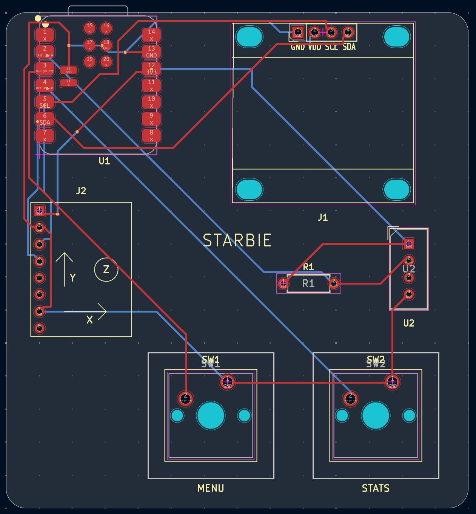
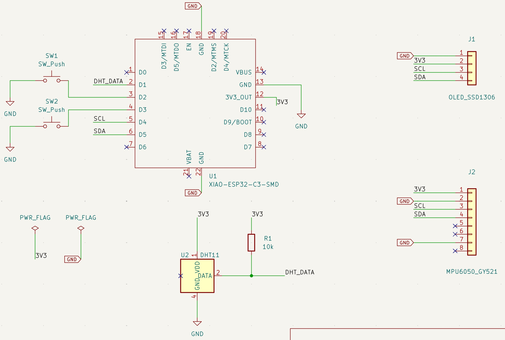

# Starbie — routed PCB for review

Starbie is a beginner electronics project based on the [Starbie Week 1 guide](https://github.com/SharKingStudios/Starbie/blob/main/Week%201%20Guide.md). It combines a Seeed XIAO ESP32-C3, two buttons, an OLED display connection, a motion-sensor connection and a DHT11 temperature/humidity sensor.

## Current status — 16 November 2026

- Full schematic and seven physical component footprints included.
- 70 × 75 mm rounded board with USB access at its top edge.
- All 20 previously outstanding connections routed on two copper layers.
- 0.30 mm tracks; 10 through vias, 0.60 mm diameter / 0.30 mm drill.
- KiCad 10 DRC: **0 violations, 0 unconnected items, 0 schematic parity issues**. The JSON report is in `checks/`.
- Gerber and plated/non-plated drill files exported into `manufacturing_review/`.
- No hardware has been assembled, powered or tested. Firmware is not implemented in this package.

This is a routed review version, not an authorization to order. Exact purchased module dimensions, pin order and assembly method still need checking. A clean DRC confirms consistency with the digital design rules; it does not prove that a selected module fits or that the physical device works. The routing includes vias near/within controller pads, which should be reviewed for the intended soldering method before manufacture.

## Opening the project

Extract the entire folder and open `Starbie.kicad_pro` in KiCad 10. Keep the `Week 1 Care Package` folder beside the project files: the symbol and footprint libraries use project-relative paths. Open the PCB Editor to see the new copper routing. The earlier placement-only project remains a separate copy.

Red tracks are front copper; blue tracks are back copper. Vias are plated holes connecting the two sides. No ground pour has been added; ground is connected using tracks.

The schematic below shows how the controller, buttons, display and sensors connect.

## Connections for eventual firmware

| Function | XIAO label | ESP32-C3 GPIO |
|---|---|---|
| OLED / MPU6050 SDA | D5 | GPIO7 |
| OLED / MPU6050 SCL | D4 | GPIO6 |
| DHT11 DATA | D1 | GPIO3 |
| Button SW1 | D2 | GPIO4 |
| Button SW2 | D3 | GPIO5 |

The I²C assignment is deliberately explicit: eventual firmware should initialize SDA on GPIO7 and SCL on GPIO6. Both buttons connect to GND when pressed and require the corresponding input pull-ups in firmware. MPU6050 AD0 is tied to GND; check address 0x68 when testing. R1 is a 10 kΩ pull-up from DHT_DATA to 3V3. Power is intended through the XIAO's USB connector; VBAT and VBUS pads are not connected on this carrier board.

## Draft bill of materials

These are candidate parts and listed prices from the sourcing comparison, not a completed funding budget. Prices below are in **GBP**, as listed by the suppliers. The dashboard requires the final purchase prices in **USD**, including tax and delivery.

| Reference | Part | Quantity to buy | Unit price (GBP) | Buying link |
|---|---|---:|---|---|
| U1 | Seeed XIAO ESP32-C3, board with loose headers | 1 | £5.40 | [The Pi Hut](https://thepihut.com/products/seeed-xiao-esp32c3) |
| J1 | HCMODU0164 SSD1306 0.96-inch I²C OLED | 1 | £3.33 excluding VAT | [Hobby Components](https://hobbycomponents.com/displays/1160-096-i2c-iic-oled-module) |
| J2 | ST071 GY-521 / MPU6050 module | 1 | From £3.27; confirm variant | [Bitsbox](https://www.bitsboxuk.com/index.php?main_page=product_info&products_id=3059) |
| U2 | ST092 bare four-pin DHT11 | 1 | £1.85 | [Bitsbox](https://www.bitsboxuk.com/index.php?main_page=product_info&products_id=3679) |
| SW1, SW2 | CHERRY MX1A-G1NW PCB-mount brown switch | 2 | £0.48 | [Keyboard Company](https://www.keyboardco.com/product/cherry-key-switch-module-brown-tactile-pcb-mount.asp) |
| R1 | MR2510K 10 kΩ axial resistor | 10 minimum; fit one | £0.06 | [Bitsbox](https://www.bitsboxuk.com/index.php?cPath=83_88&main_page=product_info&products_id=594) |
| Headers | CN344 40-way 2.54 mm header strip | 1 strip | £0.24 | [Bitsbox](https://www.bitsboxuk.com/index.php?cPath=225_230&main_page=product_info&products_id=2409) |
| PCB | Custom two-layer 70 × 75 mm board | Manufacturer's minimum batch | Quote required | [JLCPCB quotation](https://jlcpcb.com/) |

The listed component subtotal is **£15.65**, excluding OLED VAT, PCB fabrication and all delivery charges. The initial UK supplier combination exceeds the dashboard's **$30 budget** once known postage and the advertised PCB base option are included; other charges remain unquoted. See [SOURCING.md](SOURCING.md) for the assumptions, supplier checks and outstanding costs. The dashboard-synced [BOM.csv](BOM.csv) currently contains only a shipping placeholder and still needs the actual parts and costs. Tools are handled separately by the programme's shop.

## Imported component models

The bundled STEP files are reference models of purchased components from the tutorial care package. They are not a custom enclosure designed for this project. The editable PCB and schematic sources are the included KiCad files. No original Fusion or Onshape enclosure model is claimed here.

## Remaining work

1. Select exact compatible parts and confirm their documentation, dimensions and connector order.
2. Review soldering access, module clearances, USB access and any enclosure needs.
3. Recheck/export if any footprint or placement changes are needed.
4. Prepare a real priced BOM within the approved budget and publish the project repository.
5. Document the participant's active work and the help used; submit through the programme's checklist.
6. After approval, assemble and test the hardware, then implement and test firmware.

## Attribution

Based on SharKingStudios' Starbie tutorial. Schematic completion, footprint corrections, component placement, PCB routing, checks, exports and documentation.
